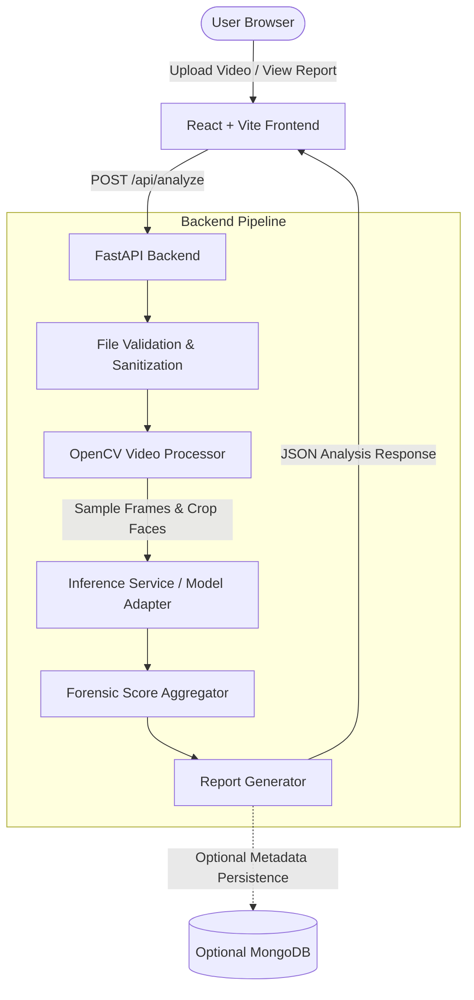

# TruthLens AI Architecture

## 1. System Overview

TruthLens AI is an AI-powered digital media forensics platform engineered for rapid, transparent, and interpretable deepfake detection in video files.

## 2. Key Modules & Separation of Concerns

### Frontend (`frontend/`)
- **Pages**: Top-level routes (`HomePage`, `AnalyzePage`, `ResultsPage`, `NotFoundPage`).
- **Components**:
  - `common/`: Reusable UI elements (Buttons, Badges, Modals, Cards, Alerts).
  - `layout/`: App shell, Navbar, Footer.
  - `upload/`: Dropzone, file validator, video previewer.
  - `analysis/`: Stepper progress, skeleton loaders, status pills.
  - `results/`: Score gauge, frame carousel, findings list, limitations callout.
- **Services**: Axios API client with standardized error handling and interceptors.
- **Types**: Strictly typed interfaces reflecting backend Pydantic schemas.

### Backend (`backend/`)
- **API Layer (`app/api/`)**: Router declarations and endpoint handlers.
- **Core (`app/core/`)**: Configuration via `pydantic-settings`, structured logging, and CORS definitions.
- **Schemas (`app/schemas/`)**: Data transfer objects for requests and responses.
- **Services (`app/services/`)**:
  - `video_processor.py`: Video decoding, frame sampling, Haar/MTCNN face detection.
  - `model_service.py`: Model inference abstraction.
  - `analysis_service.py`: Orchestrator linking extraction, inference, and response assembly.
- **Models (`app/models/`)**: Model loader adapter isolating pretrained weights and architecture.
- **Database (`app/database/`)**: Decoupled MongoDB connection and repository pattern.
- **Utils (`app/utils/`)**: File extension verification, MIME type checks, cleanup routines.

## 3. Data Flow

1. **Ingestion**: User selects or drops an `.mp4`, `.mov`, `.avi`, or `.webm` file (max 100MB).
2. **Validation**: Frontend conducts client-side size and MIME check; backend verifies decodability via OpenCV.
3. **Sampling**: Frames are uniformly sampled at a configurable rate (e.g., 1 frame every 0.5s, up to 20 frames).
4. **Face Extraction**: Frontal faces are extracted with bounding margin padding and resized to model dimensions.
5. **Inference**: Extracted faces are evaluated by the loaded PyTorch model.
6. **Aggregation**: Frame-level scores are aggregated (e.g. 75th percentile / top-k mean) to compute the risk score.
7. **Report**: Result categorization (`potential_manipulation_detected`, `no_strong_signs_detected`, `unable_to_assess`) is returned to the client.
8. **Cleanup**: Temp video files are deleted from the server buffer immediately.
